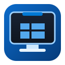

<div align="center">



<h1>WinRDP</h1>

<p>
  <strong>Ứng dụng Remote Desktop (RDP) chuẩn Windows <code>mstsc.exe</code> cho Ubuntu &amp; Linux</strong><br />
  GTK4 + Libadwaita + OpenGL 3.3 &bull; Tích hợp sẵn FreeRDP 3.33.1 với FFmpeg H.264/AVC444 &amp; Intel VA-API
</p>

<p>
  <a href="https://github.com/tienspextre/winrdp/releases">
    
  </a>
  <a href="LICENSE">
    
  </a>
  
  
  
</p>

<p>
  <a href="README.md">English</a> &nbsp;|&nbsp; <strong>Tiếng Việt</strong>
</p>

</div>

---

WinRDP được thiết kế để khắc phục triệt để các điểm khó chịu thường gặp của RDP client trên Linux — chớp đen khi fullscreen, kẹt bộ gõ tiếng Việt, rớt bắt phím, thanh tiêu đề bị lẹm lên thanh top bar hoặc vỡ đa màn hình — mang lại trải nghiệm mượt mà tương tự `mstsc.exe` trên Windows cho cả **Wayland** lẫn **X11**.

## Mục lục

1. [Tính năng nổi bật](#1-tính-năng-nổi-bật)
2. [Tương thích & Cài đặt nhanh](#2-tương-thích--cài-đặt-nhanh)
3. [Hướng dẫn giao diện Connection Manager](#3-hướng-dẫn-giao-diện-connection-manager)
4. [Cấu hình chi tiết 5 tab Profile](#4-cấu-hình-chi-tiết-5-tab-profile)
5. [Hướng dẫn thao tác trong phiên Remote Desktop](#5-hướng-dẫn-thao-tác-trong-phiên-remote-desktop)
6. [Phím tắt mặc định](#6-phím-tắt-mặc-định)
7. [Sử dụng qua dòng lệnh CLI](#7-sử-dụng-qua-dòng-lệnh-cli)
8. [Vị trí lưu dữ liệu & Xử lý sự cố](#8-vị-trí-lưu-dữ-liệu--xử-lý-sự-cố)
9. [Build từ mã nguồn & Đóng gói](#9-build-từ-mã-nguồn--đóng-gói)
10. [Giấy phép](#10-giấy-phép)

---

## 1. Tính năng nổi bật

| Nhóm chức năng | Chi tiết tính năng |
| --- | --- |
| **Đồ họa & Kết xuất GPU** | 1 cửa sổ `GtkOverlay` duy nhất kết hợp OpenGL 3.3 dirty-rect (`glTexSubImage2D`) không nháy đen; tự chọn `GL_NEAREST` sắc nét 1:1 hoặc `GL_LINEAR` khi bật Smart Sizing; tích hợp FreeRDP `3.33.1` hỗ trợ `H.264/AVC444`, `AVC420`, `RemoteFX`, giải mã phần cứng Intel VA-API (`LIBVA_DRIVER_NAME=iHD`) và Dynamic Resolution (`MS-RDPEDISP`). |
| **Trải nghiệm chuẩn `mstsc.exe` (Wayland & X11)** | Thanh **Connection Bar** nổi ở cạnh trên khi fullscreen với 2 công tắc độc lập **Pin (Ghim)** và **Hide (Hotkey-Only)** cùng thông số codec/RTT/FPS trực tiếp; khi thoát sang cửa sổ tự chuyển sang thanh tiêu đề gốc `AdwHeaderBar` và căn **chính giữa vùng làm việc (*workarea*)** dưới thanh top bar Ubuntu. |
| **Đa màn hình thực sự** | Toàn màn hình gốc trên từng màn hình (`gtk_window_fullscreen_on_monitor`), kéo thả ứng dụng Windows mượt giữa các màn hình khác độ phân giải/DPI/tọa độ, bật/tắt nóng giữa phiên (`Ctrl+Alt+M`), gộp chung 1 biểu tượng trên Ubuntu Dock và tự nổi/thu nhỏ đồng bộ toàn bộ màn hình. |
| **Bắt phím Windows & Gõ tiếng Việt chuẩn** | Chuyển thẳng `Alt+Tab`, phím `Win`, `PrintScreen`, `Ctrl+Shift+Esc` vào Windows; bấm-nhả đơn `Right Ctrl` để thả/bắt lại phím (`Right Ctrl+C/V` vẫn hoạt động trong Windows); truyền mã phím thô (*scancode*) bỏ qua `GtkIMContext` giúp gõ **UniKey/EVKey** bên trong Windows không xung đột với `ibus`/`fcitx5`. |
| **Xác thực, Profile & File `.rdp`** | Quick Connect (`user@host:port`, `rdp://`, IPv6), lọc **All Connections**, **Favorites**, **Recent**, **Groups** & tìm kiếm tức thì; Import/Export file `.rdp` chuẩn **UTF-16LE / UTF-8**; tự chuẩn hóa `DOMAIN\user` / `.\localuser` / UPN + NTLM trực tiếp cho Domain NetBIOS/IP không cần Kerberos; **Remember Last Username**, **GNOME Keyring** (`libsecret`), và thanh chuyển nhanh **Active Sessions**. |
| **Âm thanh, Clipboard & Thiết bị** | Phát âm thanh Windows ra loa Ubuntu, chuyển micro, clipboard 2 chiều chữ & ảnh (+ chép file FUSE3 trên `.deb` native), **Shared Folders (`\\tsclient`)**, chuyển máy in cục bộ, tự động kết nối lại (**Auto-Reconnect** 1–50 lần), đo độ trễ mạng & **RD Gateway**. |
| **Đóng gói đa phiên bản Ubuntu** | **1 file `.flatpak` duy nhất** chạy đồng nhất trên Ubuntu 20.04–26.10 và mọi bản Linux, cùng các gói `.deb` native gọn nhẹ cho Ubuntu 24.04 LTS và Ubuntu 26.04 LTS / 26.10. |

---

## 2. Tương thích & Cài đặt nhanh

- **Display Server:** Hoạt động đầy đủ trên cả **Wayland** và **X11** (`x86_64` / `amd64`).
- **Tăng tốc phần cứng (GPU Intel):** Tự động bật `LIBVA_DRIVER_NAME=iHD` khi phát hiện GPU Intel và driver Intel VA-API (`intel-media-va-driver` trên host hoặc `org.freedesktop.Platform.VAAPI.Intel` trong Flatpak).
- **Lưu mật khẩu:** Dùng `gnome-keyring` qua `libsecret` (`org.freedesktop.secrets`, có sẵn trên Ubuntu Desktop).

### So sánh các gói cài đặt

| Gói cài đặt | Phiên bản OS hỗ trợ | Thư viện & Runtime | Chép file qua Clipboard | Shared Folders (`\\tsclient`) |
| --- | --- | --- | --- | --- |
| **Flatpak 1 file duy nhất** *(Khuyên dùng)* | Ubuntu **20.04 – 26.10** & mọi bản Linux | Kèm sẵn GNOME 50 + FreeRDP 3.33.1 | Văn bản & Hình ảnh *(trong sandbox)* | Có (`--filesystem=home`) |
| **`.deb` native (`ubuntu26.04`)** | Ubuntu **26.04 LTS** & **26.10** | Dùng GTK4/FFmpeg hệ thống + FreeRDP 3.33.1 đóng gói kèm | Có (**FUSE3** + Văn bản/Ảnh) | Có |
| **`.deb` native (`ubuntu24.04`)** | Ubuntu **24.04 LTS** | Dùng GTK4/FFmpeg hệ thống + FreeRDP 3.33.1 đóng gói kèm | Có (**FUSE3** + Văn bản/Ảnh) | Có |

### Cách 1: 1 file cài duy nhất cho mọi bản Ubuntu — Flatpak (Khuyên dùng)

Chỉ cần **1 file `.flatpak` duy nhất** để chạy ổn định trên **Ubuntu 20.04, 22.04 LTS, 24.04 LTS, 26.04 LTS, 26.10** và các bản Linux khác mà không lo lệch phiên bản thư viện hệ thống:

```bash
# Cài Flatpak nếu máy chưa có
sudo apt update && sudo apt install -y flatpak

# Tải và cài đặt WinRDP (lần đầu Flatpak tự tải runtime nền từ Flathub)
wget https://github.com/tienspextre/winrdp/releases/download/v1.3.0/winrdp_1.3.0_x86_64.flatpak
flatpak install --user -y ./winrdp_1.3.0_x86_64.flatpak
```

Mở **WinRDP** từ menu ứng dụng Ubuntu hoặc chạy trong terminal:

```bash
flatpak run io.winrdp.Client
```

- **Nâng cấp:** `flatpak install --user -y --reinstall ./winrdp_<phiên_bản>_x86_64.flatpak`
- **Gỡ cài đặt:** `flatpak uninstall --user -y io.winrdp.Client`

### Cách 2: Gói `.deb` native (Ubuntu 24.04 LTS / 26.04 LTS / 26.10)

Nếu bạn muốn gói cài đặt nhẹ trên các bản Ubuntu mới, tải đúng file `.deb` tại **[GitHub Releases](https://github.com/tienspextre/winrdp/releases)**:

- **Ubuntu 26.04 LTS / Ubuntu 26.10:**

```bash
wget https://github.com/tienspextre/winrdp/releases/download/v1.3.0/winrdp_1.3.0_ubuntu26.04_amd64.deb
sudo apt update
sudo apt install ./winrdp_1.3.0_ubuntu26.04_amd64.deb
```

- **Ubuntu 24.04 LTS:**

```bash
wget https://github.com/tienspextre/winrdp/releases/download/v1.3.0/winrdp_1.3.0_ubuntu24.04_amd64.deb
sudo apt update
sudo apt install ./winrdp_1.3.0_ubuntu24.04_amd64.deb
```

- **Nâng cấp / Gỡ gói `.deb`:** `sudo apt install ./winrdp_<phiên_bản>_ubuntu<bản>_amd64.deb` hoặc `sudo apt remove winrdp`.

### Kiểm tra toàn vẹn SHA-256 (tùy chọn cho cả `.flatpak` lẫn `.deb`)

```bash
wget https://github.com/tienspextre/winrdp/releases/download/v1.3.0/SHA256SUMS.txt
sha256sum -c --ignore-missing SHA256SUMS.txt
```

---

## 3. Hướng dẫn giao diện Connection Manager

Mở **WinRDP** từ menu ứng dụng Ubuntu hoặc chạy lệnh `winrdp` (hoặc `flatpak run io.winrdp.Client`). Giao diện quản lý gồm 4 khu vực:

### Thanh Quick Connect (Kết nối nhanh)
Nằm ở thanh tiêu đề trên cùng:
- Nhập địa chỉ máy Windows vào ô **Quick Connect** với các định dạng được hỗ trợ:
  - IP / Tên máy: `192.168.1.50`, `win11-dev`
  - Kèm tài khoản & cổng: `user@192.168.1.50`, `user@192.168.1.50:3390`
  - Kèm domain & URI: `rdp://CORP\user@10.0.0.5:3389`, `DOMAIN/user@host`
  - IPv6: `[fe80::1]:3389`
- Bấm nút **Multi-Monitor** ngay cạnh ô nhập để bật/tắt tràn toàn bộ màn hình (mặc định **tự bật sẵn** nếu máy Ubuntu đang nối từ 2 màn hình trở lên).
- Nhấn `Enter` hoặc bấm **Connect**.

### Thư viện & Quản lý Profile
- **Tạo mới (`+`):** Mở hộp thoại cấu hình 5 tab và lưu lại để dùng lâu dài.
- **Kết nối:** Bấm nút **Connect** hoặc **double-click** vào thẻ kết nối.
- **Thao tác nhanh trên thẻ:** Đánh dấu sao yêu thích (`★`), Sửa (biểu tượng bút), Xuất `.rdp` (biểu tượng lưu) và Xóa (biểu tượng thùng rác).
- **Cột trái (Library):** Lọc theo **All Connections**, **Favorites**, **Recent**, hoặc từng **Group** tự đặt trong profile.
- **Tìm kiếm (`🔍`):** Lọc tức thì theo tên hiển thị, hostname/IP, username hoặc group.

### Nhập & Xuất file `.rdp` Windows
- **Import .rdp File (biểu tượng thư mục):** Đọc trực tiếp file `.rdp` tạo từ `mstsc.exe` trên Windows (hỗ trợ cả **UTF-16LE** và **UTF-8**, cùng các tham số `selectedmonitors`, `displayconnectionbar`, `use multimon`).
- **Export .rdp (nút trên thẻ):** Xuất profile ra file `.rdp` để sao lưu hoặc mở trên máy Windows.

### Thanh Active Sessions
Khi có ít nhất một phiên RDP đang mở, thanh **Active Sessions** sẽ hiện ngay dưới thanh tiêu đề của Connection Manager:
- Bấm vào tên phiên để **đưa thẳng cửa sổ remote lên trước / khôi phục nếu đang thu nhỏ** (kể cả khi phiên đang mở trên nhiều màn hình).
- Bấm nút `×` bên cạnh tên phiên để ngắt kết nối nhanh.

---

## 4. Cấu hình chi tiết 5 tab Profile

Khi bấm **New Connection (`+`)** hoặc **Edit Connection**, hộp thoại gồm 5 tab đầy đủ tiêu đề:

### Tab 1: General
- **Display Name / Group (optional) / Favorite:** Tên hiển thị trên thẻ, nhóm gom ở sidebar trái và ghim vào mục yêu thích.
- **PC Name / Host / IP & RDP Port:** Địa chỉ máy Windows đích và cổng RDP (mặc định `3389`).
- **Username / Domain (optional) / Password:** Thông tin đăng nhập Windows. Bạn có thể điền tách riêng **Username** và **Domain**, hoặc gõ trực tiếp dạng `DOMAIN\user`, `.\localuser` hay UPN (`user@domain.vn`) vào ô **Username** — WinRDP tự chuẩn hóa sạch trước khi xác thực và dùng NTLM trực tiếp cho Domain NetBIOS / địa chỉ IP ngay cả khi Ubuntu chưa cấu hình Kerberos.
- **Remember Last Username:** Tự lưu lại Username + Domain vừa dùng gần nhất khi bấm **Connect** (hoạt động cả khi **tắt** lưu mật khẩu để lần sau không cần nhập lại tên tài khoản).
- **Save Password in GNOME Keyring:** Mã hóa mật khẩu qua `libsecret`, không bao giờ lưu chữ thô trong file JSON.

### Tab 2: Display
- **Display Mode:**
  - `Fullscreen (Single Monitor)`: Toàn màn hình trên 1 màn hình Ubuntu.
  - `Windowed`: Cửa sổ có thanh tiêu đề để kéo, di chuyển và đổi kích thước tự do.
  - `Multi-Monitor (Fullscreen)`: Mở rộng desktop Windows ra nhiều màn hình Ubuntu.
- **Resolution Preset & Desktop Width / Height:** Chọn `Custom / Native` hoặc các preset sẵn (`1920 x 1080`, `2560 x 1440`, `3840 x 2160`, `1600 x 900`, `1280 x 720`).
- **Dynamic Resolution (`MS-RDPEDISP`):** Tự động cập nhật độ phân giải desktop Windows cho khớp kích thước mỗi khi kéo cửa sổ hoặc chuyển Fullscreen/Windowed.
- **Smart Sizing:** Co giãn hình ảnh Windows vừa khung cửa sổ. Nên **tắt** để giữ từng điểm ảnh 1:1 sắc nét nhất (`GL_NEAREST`), hoặc **bật** khi cần thu gọn màn hình độ phân giải cao vào cửa sổ nhỏ.
- **Remote Windows DPI Scaling:** `Auto`, `100%`, `125%`, `150%`, `200%`.
- **Pin Connection Bar & Hide Connection Bar (Hotkey-Only):** Hai công tắc độc lập điều khiển thanh Connection Bar ở chế độ Fullscreen:

| `Hide Connection Bar` | `Pin Connection Bar` | Hành vi trong Fullscreen |
| --- | --- | --- |
| **Tắt** | **Tắt** | **Auto-Hide:** Mặc định ẩn; rê chuột lên sát mép trên giữa màn hình để trượt xuống và tự ẩn khi rời chuột. |
| **Bật** | **Tắt** | **Hotkey-Only:** Tắt kích hoạt bằng chuột ở mép trên; chỉ nhấn **`Ctrl+Alt+Home`** để hiện, tự ẩn sau khi dùng hoặc nhấn `Ctrl+Alt+Home` lần nữa. |
| **Tắt** hoặc **Bật** | **Bật** | **Luôn hiển thị:** Thanh được ghim cố định. Nếu bật cả **Hide** và **Pin**, khi bỏ ghim (`Unpin`), thanh sẽ ẩn ngay và quay về chế độ `Ctrl+Alt+Home`. |

- **Monitors:**
  - Khi chọn `Multi-Monitor (Fullscreen)`: Bật **Use All Connected Monitors** để dùng toàn bộ màn hình, hoặc tắt đi để tích chọn từng màn hình cụ thể.
  - Khi chọn `Fullscreen (Single Monitor)`: Dùng mục **Target Fullscreen Monitor** để cố định màn hình Ubuntu sẽ mở phiên remote.

### Tab 3: Resources
- **Remote Audio Playback:** `Play on this computer (Ubuntu)`, `Play on remote Windows`, hoặc `Do not play`.
- **Redirect Microphone:** Truyền micro từ Ubuntu vào Windows cho họp/gọi trực tuyến.
- **Clipboard (Text & Images):** Copy/paste văn bản và hình ảnh 2 chiều.
- **Clipboard File Copy/Paste:** Copy/paste file 2 chiều qua **FUSE3** *(hoạt động trên gói `.deb` native / build từ mã nguồn; trên bản Flatpak sandboxed, dùng mục **Shared Folders (`\\tsclient`)** để trao đổi file)*.
- **Redirect Local Printers:** Chia sẻ máy in cục bộ vào phiên Windows.
- **Capture System Shortcuts (`Win`, `Alt+Tab`, `PrtSc`):** `Only in Fullscreen` *(khuyên dùng)*, `Always when focused`, hoặc `Never`.
- **Release Keyboard Grab Key:** Chọn phím bấm-nhả đơn để nhả/bắt lại bàn phím (`Right Ctrl`, `Right Alt`, hoặc `Scroll Lock`).
- **Shared Folders (`\\tsclient`):** Bấm **Add Folder** để chia sẻ thư mục Ubuntu vào Windows; trong Windows mở File Explorer và nhập `\\tsclient` để truy cập.

### Tab 4: Experience
- **Graphics Codec:** Khuyên dùng `Auto (AVC444 -> AVC420 -> RemoteFX)` hoặc chọn thủ công `H.264 / AVC444 (Crisp text + 60fps)`, `H.264 / AVC420 (Low bandwidth)`, `RemoteFX (Classic GFX)`, hoặc `Standard GDI (Legacy)`.
- **Hardware Video Decode (Intel VA-API):** Giảm tải CPU bằng giải mã phần cứng GPU Intel UHD/Iris.
- **Tùy chọn hiển thị Windows:** Font Smoothing (ClearType), Desktop Composition, Show Window Contents While Dragging, Menu & Window Animations, Desktop Background Wallpaper.
- **Auto-Reconnect on Drop & Max Reconnect Attempts:** Tự động kết nối lại tối đa `1–50` lần khi rớt mạng tạm thời mà không làm thoát fullscreen.
- **Network Auto-Detect (Live Latency/RTT):** Đo độ trễ thực tế (ms) và hiển thị chất lượng mạng trên Connection Bar.

### Tab 5: Advanced
- **Security Layer:** `Auto Negotiate`, `NLA (CredSSP — Recommended)`, `TLS`, hoặc `Classic RDP`.
- **Ignore Certificate Warnings:** Bỏ qua hộp thoại xác nhận chứng chỉ TLS tự ký *(nên tắt khi kết nối qua mạng công cộng không tin cậy)*.
- **RD Gateway Server:** Cấu hình địa chỉ Gateway, cổng (mặc định `443`), và chọn dùng chung hoặc tách riêng tài khoản Gateway.

---

## 5. Hướng dẫn thao tác trong phiên Remote Desktop

### Chế độ Fullscreen & Thanh Connection Bar
Khi đang ở toàn màn hình, thanh **Connection Bar** nằm gọn trong cùng cửa sổ `GtkOverlay` để tránh chớp màn hình:
- **Pin (`📌`):** Ghim thanh luôn hiện hoặc cho phép tự ẩn.
- **Biểu tượng sóng + huy hiệu Codec:** Rê chuột để xem độ phân giải, codec (`AVC444 VA`, `AVC420`, `RFX`), độ trễ RTT (`ms`) và `fps` thực tế.
- **Biểu tượng bàn phím (Capture):** Bật/tắt bắt phím hệ thống (`Alt+Tab`, `Win`).
- **Biểu tượng ổ khóa (`Send Ctrl+Alt+Del`):** Gửi tổ hợp `Ctrl+Alt+Del` tới màn hình khóa/đăng nhập Windows.
- **Biểu tượng kính lúp (`Smart Sizing`):** Chuyển nhanh giữa tỷ lệ 1:1 sắc nét và co giãn vừa cửa sổ.
- **Mũi tên lên (`^`):** Thu gọn thanh (khi không ghim, kích hoạt ẩn chỉ mở lại bằng `Ctrl+Alt+Home`).
- **Thu nhỏ / Đa màn hình / Thoát Fullscreen (`Windowed`) / Đóng (`×`).**

### Chế độ Windowed (Cửa sổ có thanh tiêu đề)
Nhấn `Ctrl+Alt+Enter` hoặc nút Restore trên Connection Bar để thoát sang chế độ cửa sổ:
- WinRDP tự thu kích thước gọn và căn **chính giữa vùng làm việc (*workarea*)** — cách đều bên dưới thanh top bar của Ubuntu trên cả **X11** và **Wayland** để thanh tiêu đề gốc `AdwHeaderBar` luôn thoáng và dễ kéo di chuyển.
- Thanh tiêu đề hiển thị độ phân giải, codec, FPS hiện tại cùng đầy đủ nút điều khiển nhanh (Capture bàn phím, `Ctrl+Alt+Del`, Smart Sizing, Multi-Monitor, vào lại Fullscreen).

### Sử dụng Nhiều màn hình (Multi-Monitor)
- **Tự mở rộng khi kết nối:** Profile `Multi-Monitor` hoặc nút Multi-Monitor trên Quick Connect sẽ mở rộng Windows ra tất cả màn hình Ubuntu đã chọn ngay khi vào phiên.
- **Bật/tắt nóng ngay trong phiên:** Nhấn `Ctrl+Alt+M` hoặc bấm nút Multi-Monitor để chuyển qua lại giữa 1 màn hình và nhiều màn hình mà không cần ngắt kết nối.
- **Kéo thả ứng dụng Windows qua lại giữa các màn:** Nắm thanh tiêu đề cửa sổ Windows bất kỳ kéo thẳng sang màn hình kia (hỗ trợ cả khi 2 màn khác độ phân giải, khác tỷ lệ DPI hoặc đặt lệch vị trí).
- **Gom nhóm Ubuntu Dock & nổi đồng bộ:** Toàn bộ các màn hình của 1 phiên được gộp thành **1 cửa sổ phiên remote duy nhất** trên Ubuntu Dock / `Alt+Tab`. Khi đang dùng app Ubuntu mà quay lại Windows bằng cách bấm vào bất kỳ màn hình nào của WinRDP, tất cả các màn hình còn lại của phiên remote sẽ tự nổi lên cùng lúc; thu nhỏ/khôi phục cũng đồng bộ hoàn toàn.

### Bắt phím Windows & Gõ tiếng Việt chuẩn (`UniKey` / `EVKey`)
- **Chuyển trọn phím tắt Windows:** Khi Keyboard Grab bật (mặc định ở Fullscreen), các tổ hợp `Alt+Tab`, `Win+D`, `Win+R`, `Ctrl+Shift+Esc`, `PrintScreen` đều đi thẳng vào Windows.
- **Thả phím nhanh về Ubuntu:** **Bấm và nhả đơn phím `Right Ctrl`** để nhả bắt phím ra Ubuntu mà không cần thoát Fullscreen; bấm-nhả `Right Ctrl` lần nữa để bắt lại vào Windows. *(Các tổ hợp như `Right Ctrl + C`, `Right Ctrl + V` vẫn gửi vào Windows bình thường.)*
- **Gõ tiếng Việt mượt mà:** Chuyển bộ gõ Ubuntu (`ibus` / `fcitx5`) sang tiếng Anh khi đang gõ trong WinRDP và bật **UniKey** hoặc **EVKey** trực tiếp trên Windows — do WinRDP truyền mã phím thô không đi qua `GtkIMContext`, chữ tiếng Việt sẽ không bị lặp ký tự hay kẹt dấu.

---

## 6. Phím tắt mặc định

| Phím tắt | Chức năng |
| --- | --- |
| `Ctrl + Alt + Home` *(hoặc `Pause`)* | Ẩn / hiện nhanh thanh Connection Bar (hoạt động cả khi đang ở chế độ chỉ mở bằng phím tắt) |
| `Ctrl + Alt + Enter` | Chuyển đổi nhanh giữa **Fullscreen** và **Windowed** |
| `Ctrl + Alt + M` | Bật / tắt chế độ **Nhiều màn hình (Multi-Monitor)** ngay trong phiên |
| `Ctrl + Alt + G` | Bật / tắt bắt phím hệ thống (`Win`, `Alt+Tab`, `Ctrl+Shift+Esc`) |
| `Right Ctrl` *(bấm nhả đơn)* | Nhả / bắt lại bàn phím giữa Ubuntu và Windows *(đổi phím được trong tab Resources)* |

---

## 7. Sử dụng qua dòng lệnh CLI

Dùng lệnh **`winrdp`** (nếu cài bằng `.deb` hoặc từ mã nguồn) hoặc **`flatpak run io.winrdp.Client`** (nếu cài Flatpak):

```text
winrdp [tùy_chọn] [file.rdp | rdp://... | user@host[:port]]
```

| Cờ dòng lệnh | Mô tả |
| --- | --- |
| `-v`, `--version` | In phiên bản WinRDP, phiên bản FreeRDP đóng gói kèm và trạng thái hỗ trợ H.264/HWAccel |
| `--list-monitors` | Liệt kê chỉ số (`[0]`, `[1]`...), tên cổng, độ phân giải, tọa độ và tỷ lệ DPI từng màn hình |
| `-m`, `--multimon` | Bắt buộc mở phiên ở chế độ nhiều màn hình (`Multi-Monitor Fullscreen`) |
| `--monitors <0,1,...>` | Chỉ định danh sách chỉ số màn hình (tự bật Multi-Monitor nếu chọn từ 2 màn hình trở lên) |
| `-f`, `--fullscreen` | Bắt buộc mở toàn màn hình trên 1 màn hình |
| `-w`, `--windowed` | Bắt buộc mở ở chế độ cửa sổ có thanh tiêu đề |
| `--no-bar` | Ẩn Connection Bar khi fullscreen (`Ctrl+Alt+Home` để mở lại) |
| `--pinned-bar` | Ghim thanh Connection Bar luôn hiển thị khi fullscreen |
| `--smoke-test` | Chạy bài kiểm tra tự động OpenGL 3.3, dual-canvas đa màn hình, HeaderBar, identity và VA-API |

**Ví dụ:**

```bash
# Bản cài .deb / native
winrdp                                  # Mở Connection Manager
winrdp workstation.rdp                  # Kết nối trực tiếp bằng file .rdp
winrdp rdp://user@192.168.1.50          # Kết nối nhanh qua URI RDP
winrdp --multimon user@10.0.0.5         # Mở tràn tất cả màn hình Ubuntu
winrdp --monitors 0,1 user@10.0.0.5     # Dùng màn hình 0 và 1 (xem chỉ số bằng --list-monitors)
winrdp --fullscreen --no-bar 10.0.0.5   # Fullscreen ẩn Connection Bar (mở bằng Ctrl+Alt+Home)
winrdp --windowed admin@192.168.1.20:3390

# Bản cài Flatpak
flatpak run io.winrdp.Client --list-monitors
flatpak run io.winrdp.Client --multimon user@10.0.0.5
flatpak run io.winrdp.Client --smoke-test
```

---

## 8. Vị trí lưu dữ liệu & Xử lý sự cố

### Vị trí lưu cấu hình & mật khẩu

| Thành phần | Bản native (`.deb` / Mã nguồn) | Bản Flatpak (`io.winrdp.Client`) |
| --- | --- | --- |
| **Danh sách Profile (`profiles.json`)** | `~/.config/winrdp/profiles.json` | `~/.var/app/io.winrdp.Client/config/winrdp/profiles.json` |
| **Mật khẩu đã lưu** | Lưu mã hóa trong **GNOME Keyring** (`libsecret`) | Dùng chung **GNOME Keyring** của hệ thống (`org.freedesktop.secrets`) |

### Xử lý sự cố thường gặp

1. **Chữ trên Windows hơi mờ hoặc có răng cưa nhẹ:**
   - Kiểm tra nút **Smart Sizing** (biểu tượng kính lúp) và hãy **tắt Smart Sizing** để hiển thị chuẩn 1:1 theo từng điểm ảnh (`GL_NEAREST`).
   - Trong tab **Experience**, ưu tiên codec `Auto` hoặc `H.264 / AVC444 (Crisp text + 60fps)`.
   - Giữ bật **Dynamic Resolution (`MS-RDPEDISP`)** để Windows tự khớp đúng độ phân giải thật của màn hình Ubuntu.
2. **Đa màn hình không mở rộng hết các màn hình:**
   - Chạy `winrdp --list-monitors` (hoặc `flatpak run io.winrdp.Client --list-monitors`) để kiểm tra chỉ số và độ phân giải màn hình hệ thống nhận được.
   - Đảm bảo máy Windows đích là bản **Windows Pro / Enterprise / Server** (Windows Home không có RDP server, còn Windows 7/8 cũ không hỗ trợ đầy đủ `MS-RDPEDISP` đa màn hình).
3. **Kiểm tra tăng tốc phần cứng VA-API & OpenGL 3.3:**
   - Chạy `winrdp --smoke-test` (hoặc `flatpak run io.winrdp.Client --smoke-test`) để kiểm tra `OpenGL initialized: YES`, `H.264/FFmpeg GFX support: YES` và `LIBVA_DRIVER_NAME: iHD` (trên GPU Intel). Với bản cài `.deb`, có thể cài thêm `sudo apt install intel-media-va-driver` (hoặc `intel-media-va-driver-non-free`) nếu thiếu driver.
4. **Lỗi đăng nhập Domain (`DOMAIN\user`) hoặc không muốn lưu mật khẩu:**
   - Để trống ô **Domain** nếu dùng tài khoản local Windows, hoặc điền tách **Domain** / nhập dạng `DOMAIN\user` vào ô **Username** đối với tài khoản Domain/AD. Bật **Remember Last Username** để tự nhớ tên đăng nhập gần nhất mà không cần bật **Save Password**.
5. **Không thấy thanh tiêu đề khi đang chạy hoặc không gõ phím ra Ubuntu được:**
   - Nhấn `Ctrl+Alt+Enter` để chuyển đổi qua lại giữa Fullscreen và Windowed.
   - Bấm-nhả đơn phím `Right Ctrl` nếu bàn phím đang bị bắt vào Windows.
6. **Chép file qua lại trong bản Flatpak:**
   - Vì Flatpak chạy trong sandbox cách ly không gắn FUSE mount của host (`WITH_FUSE=OFF`), clipboard trong Flatpak hỗ trợ văn bản & hình ảnh, còn chép file thực hiện qua **Shared Folders (`\\tsclient`)** ở tab **Resources**. Nếu cần copy/paste file trực tiếp bằng Ctrl+C/Ctrl+V trong File Explorer trên Ubuntu 24.04–26.10, hãy dùng gói `.deb` native.

---

## 9. Build từ mã nguồn & Đóng gói

**Công nghệ sử dụng:** C++20 &bull; GTK4 &bull; Libadwaita &bull; OpenGL 3.3 (`libepoxy`) &bull; FreeRDP `3.33.1` &bull; `libsecret` &bull; `cJSON` &bull; CMake + Ninja

```bash
./scripts/install-deps.sh                     # Cài đặt thư viện build & phụ thuộc trên Ubuntu (chạy 1 lần)
./scripts/build-freerdp3.sh                   # Build FreeRDP 3.33.1 (H.264 + VA-API + Pulse + FUSE3)
./scripts/build-app.sh                        # Biên dịch WinRDP & chạy toàn bộ CTest unit tests
./scripts/install-desktop.sh                  # Tích hợp nhanh vào ~/.local/bin & menu ứng dụng Ubuntu
./scripts/build-flatpak.sh                    # Đóng gói 1 file .flatpak duy nhất chạy mọi bản Ubuntu
./scripts/build-deb.sh                        # Đóng gói .deb native cho phiên bản Ubuntu đang chạy
./scripts/build-deb-docker.sh --ubuntu 26.04  # Build & kiểm tra cài sạch .deb cho Ubuntu 26.04 & 26.10 qua Docker
```

---

## 10. Giấy phép

WinRDP được phát hành theo **[Giấy phép Apache 2.0](LICENSE)**.
Thành phần bên thứ ba đóng gói kèm bao gồm **FreeRDP 3.33.1** (Apache-2.0).
